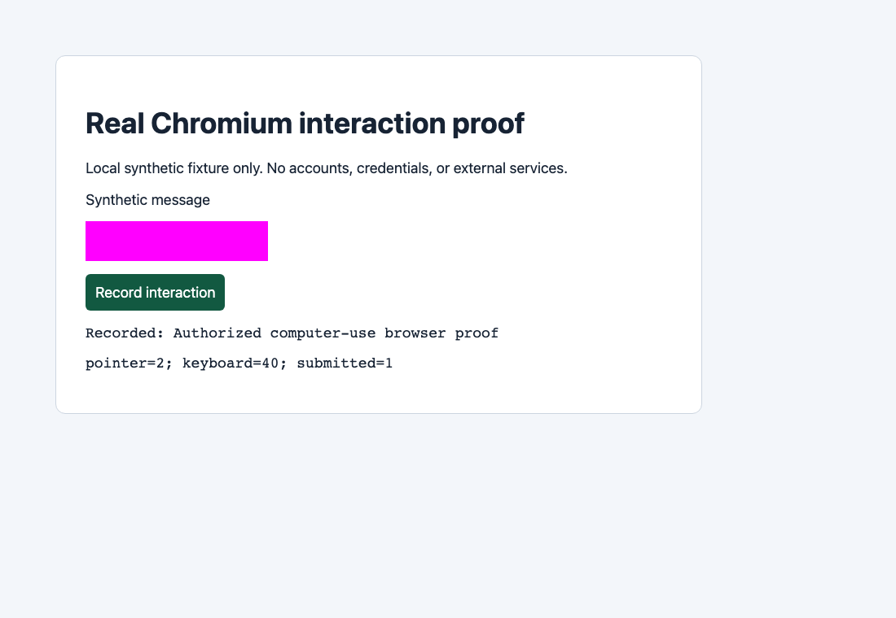

# Verification evidence

All observations below used owned temporary workspaces, synthetic keys, loopback upstreams, and isolated Chromium profiles. No live Dani Bot data, provider accounts, Google profiles, or paid model APIs were used.

## Commands exercised

```sh
npm run ci
npm run browser-smoke
npm run package-smoke
node bin/skill.mjs self-improve --demo --output artifacts/cli-improvement
```

Local runtime: Node 26.8.1 on macOS x64. CI also defines Node 22/24 Linux runs; local macOS success alone does not claim those remote jobs passed.

- Lint, strict TypeScript checks, and build passed.
- 32 regression tests passed. Coverage includes AES-GCM tamper detection, one-account/idempotent key maintenance, nested secret redaction, exact free-model restrictions, Retry-After, reset handling, persistent cooldown/RPM state, body bounds/deadlines, streaming, config preservation, shell escaping, subprocess failures, and RSI boundaries.
- A real child process was killed with SIGKILL after committing `key_saved`; re-run resumed without duplicate key generation. The lock's crash-stale window was exercised.
- CLI smoke installed a fresh workspace twice, loaded a third platform from YAML only, imported keys via stdin, served real completions through the proxy, replaced the same account key hot, rejected a paid model, retried 429 only after its cooldown, streamed SSE, and returned an honest capacity failure for an exhausted account without a near reset.
- A forced 402 with a known reset inside the wait budget succeeded after that reset using the **same key**; a long reset returned 503 plus upstream 402 metadata. Neither path created accounts or evaded limits.
- Package smoke packed a real tarball, installed it without dev dependencies, initialized a fresh directory, validated both shipped recipes, and exercised both installed browser backends.

## Computer-use proof



Both backends also rejected forbidden URLs and cross-origin redirect egress. Browser events and rendered resulting state—not log-only driver calls—were asserted. The screenshot contains only local synthetic fixture data.

## Self-improvement proof

The [curated observed decisions](evidence/improvement.json) preserve the fixture evidence without machine-specific paths or credentials.

| Candidate | Baseline score | Candidate score | Decision |
| --- | ---: | ---: | --- |
| Selector replacement | 0 | 66.66666666666666 | Promoted |
| Timeout 500 → 1000 ms | 66.66666666666666 | 66.66666666666666 | Rejected |

The rejected candidate left the adopted timeout unchanged. Runs used a zero time weight for reproducible tie rejection, while still measuring real execution durations. Separate regression tests exercise nonzero weights, exact 2% rejection, lost-success veto, negative/zero baselines, bounded persistent failure reuse, three-field-streak cap, and the three-regression hard stop.

## Not proven / not implemented

Live Zro signup/email OTP/key capture, APInex Google OAuth/key capture, disposable inbox APIs, live provider quota/pricing claims, and automated native Cline/Roo/Cursor credential stores are not claimed. Account farming/quota evasion is excluded. Computer-use is deterministic pointer/keyboard automation, not a vision-model agent. The local loop is Harness²-inspired, not upstream's model-backed research implementation.
